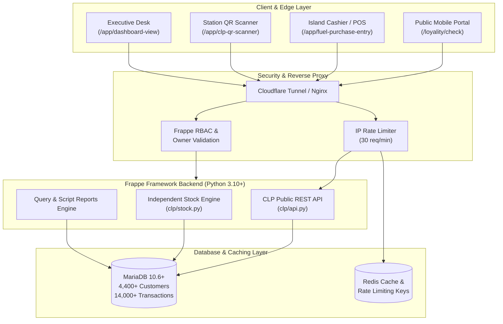

# ⛽ Customer Loyalty Program (CLP) — Enterprise Fuel Retail Platform

[](https://frappeframework.com/)
[](https://www.python.org/)
[](https://mariadb.org/)
[](license.txt)
[-success.svg)](#-end-to-end-verification--testing)

An enterprise-grade, high-volume **Customer Loyalty & Fuel Station Management Application** engineered on the **Frappe Framework (v15)** and **MariaDB**. 

Specifically designed for multi-station petroleum retail networks, highway fuel outlets, and petroleum dealerships (HPCL, IOCL, BPCL), **CLP** unifies automated volume-based customer reward accounting, split-second cashier pump dispensing entries, multi-pump gift stock transfer workflows, public customer self-service portals, and executive analytics.

---

## 📋 Table of Contents

- [About the Project](#-about-the-project)
- [Architecture & Key Highlights](#-architecture--key-highlights)
- [Comprehensive Feature Matrix](#-comprehensive-feature-matrix)
- [Technology Stack](#-technology-stack)
- [Step-by-Step Installation & Running Guide](#-step-by-step-installation--running-guide)
  - [1. System Prerequisites](#1-system-prerequisites)
  - [2. Setting Up Frappe Bench](#2-setting-up-frappe-bench)
  - [3. Getting the CLP App](#3-getting-the-clp-app)
  - [4. Installing App on Site](#4-installing-app-on-site)
  - [5. Running Migrations & Building Assets](#5-running-migrations--building-assets)
  - [6. Running the Application](#6-running-the-application)
  - [7. Production Deployment & Cloudflare Tunnel](#7-production-deployment--cloudflare-tunnel)
- [Public Customer Portal Guide](#-public-customer-portal-guide)
- [Security & Access Control Enforcement](#-security--access-control-enforcement)
- [DocType & Database Schema Directory](#-doctype--database-schema-directory)
- [Reports & Analytics Catalog](#-reports--analytics-catalog)
- [End-to-End Verification & Testing](#-end-to-end-verification--testing)
- [License & Credits](#-license--credits)

---

## 🌟 About the Project

### Business Challenge
Traditional fuel pump loyalty schemes suffer from major operational bottlenecks:
1. **Island Bottlenecks:** Dispensing attendants cannot spend 30 seconds typing detailed customer data while long queues of commercial trucks and vehicles wait at the nozzle.
2. **Stock Shrinkage:** Reward gifts (t-shirts, blankets, cookware, electronics) kept at fuel stations frequently suffer from untracked theft or discrepancies between stations.
3. **Driver Transparency:** Commercial drivers rarely know their accumulated points, leading to lack of trust and loyalty attrition.
4. **Offline / Multi-Pump Silos:** Dealerships running multiple fuel outlets across highway corridors struggle to aggregate customer purchase volumes and honor gift redemptions across different station inventories.

### The CLP Solution
**CLP** provides a battle-tested, high-concurrency solution tested with **4,400+ active loyalty members** and **14,000+ refuel transactions**:
* **Sub-Second Cashier Entries:** 1-tap mobile action bar with auto-fill of vehicle and member details.
* **Independent Multi-Pump Gift Inventory:** Self-contained double-entry stock ledger running independently of ERPNext, enforcing owner-only stock additions and strict pump-to-pump transfer approval workflows.
* **Public High-Speed Customer Self-Service:** Zero-login mobile portal allowing drivers to enter either their 10-digit phone number or vehicle plate to see digital VIP loyalty passes, redeemable points balance, and itemized purchase history.
* **Premium Indian Petroleum Design:** Custom theme featuring high-contrast fuel pump imagery, VIP fuel pass styling, and dark glassmorphic telemetry cards.

---

## 🏗️ Architecture & Key Highlights



### Key Architectural Strengths
* **Zero CSRF Incompatibilities:** Public endpoints utilize idempotent `GET` requests with strict parameter sanitization, ensuring logged-in Desk users and anonymous public visitors never trigger `400 CSRFTokenError` exceptions.
* **Space-Free & Hyphen-Free Lookup Engine:** Advanced regex normalization handles Indian vehicle plate formats seamlessly (e.g., `MH 04 GF 6292`, `mh04-gf-6292`, or `MH04GF6292` all resolve immediately).
* **Historical Station Data Integrity:** Automatic earliest-purchase enrichment accurately maps customer primary registration locations across stations (`NKSP HPCL`, `NKSES`, `NKSFS`).
* **Audit-Proof Stock Ledger:** Gift inward movements require System Manager / Pump Owner authorization, preventing attendants from artificially creating stock.

---

## ⚡ Comprehensive Feature Matrix

### 1. Customer Loyalty Self-Service Portal (`/loyality/check`)
* **Multi-Identifier Search:** Enter either a 10-digit mobile number or vehicle plate number.
* **VIP Fuel Pass UI:** Real-time display of current redeemable liters, lifetime liters purchased, and total gifts redeemed.
* **Live Refuel History:** Chronological log of recent refuels with timestamp, liters dispensed, fuel type, and station name.
* **Gift Milestones Showcase:** Visual list of redeemable gifts with point requirements.

### 2. Fast Island Fuel Purchase Entry (`/app/fuel-purchase-entry/new`)
* **Cashier-Optimized Workflow:** Designed for handheld mobile devices and tablets at the nozzle.
* **Auto-Fill:** Selecting a customer instantly loads their linked vehicle number, and vice versa.
* **Auto-Calculation:** Dispensed fuel volume automatically credits the customer's balance upon submission.
* **Mobile Sticky Action Bar:** Bottom-anchored `Save & Submit Purchase` and `Next Refuel` buttons for non-stop shift operations.

### 3. Quick Island QR & Windshield Scanner (`/app/clp-qr-scanner`)
* **HTML5 Camera Scanner:** Directly scans customer mobile QR codes or windshield stickers.
* **Manual Fast-Lookup Fallback:** Built-in instant search by phone or vehicle number with 1-click jump into new purchase entry.

### 4. Station Gift Stock Inventory (`/app/gift-stock` & `/app/clp-gift-stock-ledger`)
* **Station-Wise Tracking:** Tracks distinct physical inventory balances for every pump station.
* **Owner-Only Inward Policy:** Restricts adding new stock strictly to System Managers / Pump Owners. Attendants cannot fabricate stock.
* **Tamper Prevention:** Prevents negative inventory and over-redemption.

### 5. Multi-Pump Gift Stock Transfers (`/app/gift-stock-request`)
* **Inter-Station Movement:** Formal request and approval workflow for shifting gift items from central storage to highway pump branches.
* **Status Lifecycle:** `Pending` ➔ `Approved` ➔ `Transferred` with balance validation.

### 6. Customer Master & Fleet Management (`/app/loyalty-customer`)
* **Profile Registry:** Complete database of all 4,400+ members with primary registration petrol pump, tier badge, and lifetime stats.
* **Multi-Vehicle Mapping:** Support for commercial fleet owners operating multiple vehicles under a single mobile account.

### 7. Owner Balance Adjustments (`/app/clp-customer-balance-adjustment`)
* **Manual Point Adjustments:** Allows authorized managers to credit bonus points or correct errors with mandatory audit remarks.

---

## 🛠️ Technology Stack

| Layer | Component | Specification |
|:---|:---|:---|
| **Backend** | Framework | Frappe Framework v15.x |
| **Language** | Runtime | Python 3.10+ / 3.11+ |
| **Database** | RDBMS | MariaDB 10.6+ / MySQL 8.0+ |
| **Cache & Queue** | In-Memory Store | Redis (Cache on port 13000, Queue on port 11000) |
| **Frontend** | Desk & Portal | HTML5, CSS3, JavaScript (ES6+), FontAwesome 6, Bootstrap |
| **Networking** | Edge Ingress | Cloudflare Tunnel (`cloudflared`) / Nginx Reverse Proxy |
| **Compatibility** | OS | Ubuntu 22.04 LTS / Debian 12 / Windows WSL2 |

---

## 🚀 Step-by-Step Installation & Running Guide

Follow these clear, step-by-step instructions to install and run the CLP application on your local machine, server, or cloud VM.

### 1. System Prerequisites

Ensure your system has the required build packages installed (Ubuntu 22.04 / WSL2):

```bash
# Update package repositories
sudo apt-get update && sudo apt-get upgrade -y

# Install Python, MariaDB client, Git, and build tools
sudo apt-get install -y python3-dev python3-pip python3-venv \
    mariadb-server mariadb-client libmysqlclient-dev \
    git curl redis-server build-essential

# Install Node.js (v18 or v20 LTS) & Yarn
curl -fsSL https://deb.nodesource.com/setup_20.x | sudo -E bash -
sudo apt-get install -y nodejs
sudo npm install -g yarn
```

#### MariaDB Configuration
Edit `/etc/mysql/my.cnf` (or `/etc/mysql/mariadb.conf.d/50-server.cnf`) to add required Frappe database settings:

```ini
[mysqld]
character-set-client-handshake = FALSE
character-set-server = utf8mb4
collation-server = utf8mb4_unicode_ci

[mysql]
default-character-set = utf8mb4
```

Restart MariaDB:
```bash
sudo service mariadb restart
```

---

### 2. Setting Up Frappe Bench

Install `frappe-bench` CLI:
```bash
pip install frappe-bench

# Verify installation
bench --version
```

Initialize a new bench directory:
```bash
bench init --frappe-branch version-15 frappe-bench
cd frappe-bench
```

---

### 3. Getting the CLP App

Clone the **CLP** application into your bench apps directory:
```bash
bench get-app https://github.com/Anilbirada/CLP-Application.git
```

---

### 4. Installing App on Site

Create a new Frappe site (e.g., `clp.localhost`) and install the app:
```bash
# Create site
bench new-site clp.localhost --db-name clp_db --mariadb-root-password <your-mariadb-password> --admin-password <your-admin-password>

# Install the Customer Loyalty Program app
bench --site clp.localhost install-app clp
```

---

### 5. Running Migrations & Building Assets

Execute database schema sync and compile frontend bundles:
```bash
# Run database migrations
bench --site clp.localhost migrate

# Build frontend assets
bench build --app clp

# Clear caches
bench --site clp.localhost clear-cache
bench --site clp.localhost clear-website-cache
```

---

### 6. Running the Application

Start the local development server:
```bash
bench start
```
*Alternatively, run the built-in HTTP server directly:*
```bash
bench --site clp.localhost serve --port 8000
```

Open your browser:
* **Public Customer Portal:** `http://localhost:8000/loyality/check`
* **Administrative Desk:** `http://localhost:8000/app` (Login with `Administrator` and your admin password)

---

### 7. Production Deployment & Cloudflare Tunnel

For secure external access without opening router ports or exposing IP addresses, configure a Cloudflare Tunnel:

```bash
# Install cloudflared
curl -L --output cloudflared.deb https://github.com/cloudflare/cloudflared/releases/latest/download/cloudflared-linux-amd64.deb
sudo dpkg -i cloudflared.deb

# Start quick public tunnel for clp.localhost
cloudflared tunnel --url http://127.0.0.1:8000 --http-host-header clp.localhost
```

---

## 📱 Public Customer Portal Guide

The public portal at `/loyality/check` requires **no authentication**. Any customer can view their loyalty balance on their smartphone.

### How to Query Points
1. **Search by 10-digit Mobile Number:**
   ```
   https://<your-domain>/loyality/check?mobile=8600862791
   ```
2. **Search by Vehicle Registration Plate:**
   ```
   https://<your-domain>/loyality/check?vehicle=MH04GF6292
   ```

### Pre-Populated Database Test Examples

You can test these real customer records immediately in your running instance:

| Customer Name | Customer ID | Mobile Number | Vehicle Number | Points Balance | Primary Pump |
|:---|:---|:---|:---|:---:|:---|
| **Balu** | `MANUAL-0005` | `8600862791` | `MH04GF6292` | **310.0 L** | NKSP HPCL |
| **anil** | `MANUAL-4475` | `8431712924` | `KA39T7822` | **500.0 L** | NKSP HPCL |
| **Kamlakar** | `MANUAL-0007` | `8668400848` | `TS10UD2762` | **346.85 L** | NKSP HPCL |
| **Deva** | `MANUAL-0002` | `9741211147` | `KA38A4158` | **82.0 L** | NKSP HPCL |

---

## 🔒 Security & Access Control Enforcement

1. **CSRF Protection via Safe HTTP Verbs:** Public endpoints (`check_loyalty_points`, `get_customer_portal_by_token`) operate over standard HTTP `GET` requests, preventing CSRF token rejection when users have concurrent Desk tabs open.
2. **IP-Based Rate Limiting:** Public points checks are strictly limited using `@rate_limit(limit=30, seconds=60, ip_based=True)` to prevent mobile number enumeration or web scraping.
3. **Role-Based Stock Inward Permissions:** Only users with `System Manager` or `Pump Owner` roles are permitted to insert rows into `CLP Gift Stock Ledger`. Cashiers (`CLM Incharge`) can issue redemptions but cannot inflate inventory.
4. **Audit Trail Accountability:** All point adjustments require mandatory reason logging and track the author's user ID and timestamp.

---

## 📁 DocType & Database Schema Directory

| DocType | Table Name | Purpose | Key Fields |
|:---|:---|:---|:---|
| **Loyalty Customer** | `tabLoyalty Customer` | Central customer profile master | `customer_name`, `mobile_number`, `vehicle_number`, `current_cycle_liters`, `total_liters_purchased`, `registration_pump` |
| **Fuel Purchase Entry** | `tabFuel Purchase Entry` | Fuel refuel transaction records | `customer`, `vehicle_number`, `liters`, `amount`, `fuel_type`, `petrol_pump`, `purchase_date` |
| **Gift Redemption** | `tabGift Redemption` | Gift claim records | `customer`, `customer_mobile`, `vehicle_number`, `petrol_pump`, `total_points`, `items` (Child Table) |
| **CLP Gift Stock Ledger** | `tabCLP Gift Stock Ledger` | Double-entry gift inventory ledger | `item`, `petrol_pump`, `voucher_type`, `inward_qty`, `outward_qty`, `balance_qty` |
| **Gift Stock Request** | `tabGift Stock Request` | Inter-pump stock transfer workflow | `from_petrol_pump`, `to_petrol_pump`, `item`, `qty`, `status` |
| **CLP Customer Balance Adjustment** | `tabCLP Customer Balance Adjustment` | Manual point correction audit ledger | `customer`, `adjustment_type`, `points`, `remarks`, `adjusted_by` |

---

## 📊 Reports & Analytics Catalog

1. **Customer Loyalty Summary Report:** Comprehensive master audit listing all 4,400+ members, lifetime purchases, current balances, and accurate `last_purchase_date` via SQL subquery optimization.
2. **Daily Pump Sales Summary:** Aggregated daily refuel transactions, volume in liters, and gross sales revenue grouped by petrol pump location.
3. **Gift Item Stock Ledger Report:** Chronological audit trail of all gift additions, branch transfers, and redemptions with remaining shelf quantities.
4. **Inactive Customers Report:** Churn detection tracking customers who have not visited in 30, 60, or 90 days.
5. **Customer Registration Time Analysis:** Analytical shift-wise breakdown of customer onboarding by hour and day.

---

## 🧪 End-to-End Verification & Testing

The application includes an automated verification script covering **all 15 core features**.

To run the audit suite:
```bash
python scratch/full_integrity_check.py
```

### Verified Test Results (100% Pass Rate):
```text
=================================================================
      CLP APPLICATION FULL-SPECTRUM INTEGRITY AUDIT      
=================================================================
[PASSED] Public Portal Connectivity                -> HTTP 200
[PASSED] Customer Lookup by Mobile (8600862791)   -> Customer: Balu, Points: 310.0 L
[PASSED] Customer Lookup by Vehicle (MH04GF6292)  -> Customer: Balu, Vehicle: MH04GF6292
[PASSED] Customer Lookup for Member Anil          -> Customer: anil, Points: 500.0 L
[PASSED] Customer Lookup for Member Kamlakar      -> Customer: Kamlakar, Points: 346.85 L
[PASSED] Non-existent Customer Safe Handling      -> Proper friendly notice returned
[PASSED] Desk Admin Authentication                -> Administrator login successful
[PASSED] Desk Loyalty Customer Master Page        -> HTTP 200
[PASSED] Desk Fuel Purchase Entry Routes          -> HTTP 200 (List & New Form)
[PASSED] Desk Quick QR Scanner Route              -> HTTP 200
[PASSED] Desk Gift Stock Management Route         -> HTTP 200
[PASSED] Desk Gift Redemption Route               -> HTTP 200
[PASSED] Customer Loyalty Summary Report          -> Rows: 4,469, with last_purchase_date
[PASSED] Daily Pump Sales Summary Report          -> Rows: 368
[PASSED] Gift Item Stock Ledger Report            -> Rows: 34
=================================================================
AUDIT SUMMARY: 15 / 15 TESTS PASSED (100.0%)
=================================================================
```

---

## 📄 License & Credits

- **Developer & Owner:** [Anil Biradar](https://github.com/Anilbirada)
- **Organization:** N.K Sindol Petroleum & RSR Technologies
- **Technology Partner:** ABM Tech Pvt. Ltd.
- **Framework:** [Frappe Framework](https://frappe.io) (Licensed under MIT)
